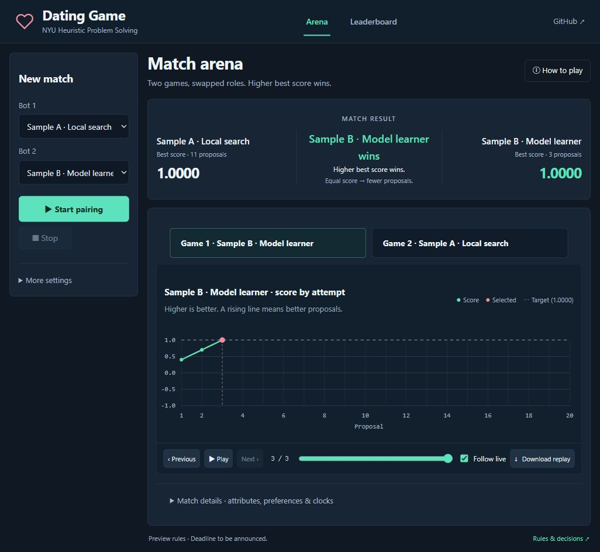
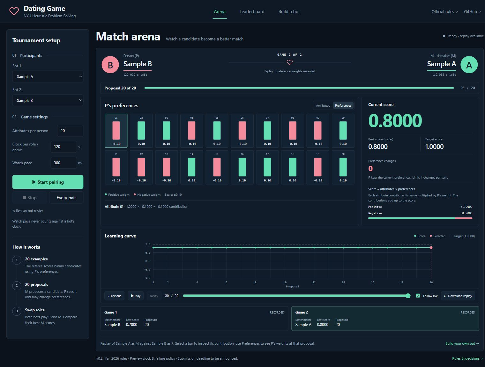
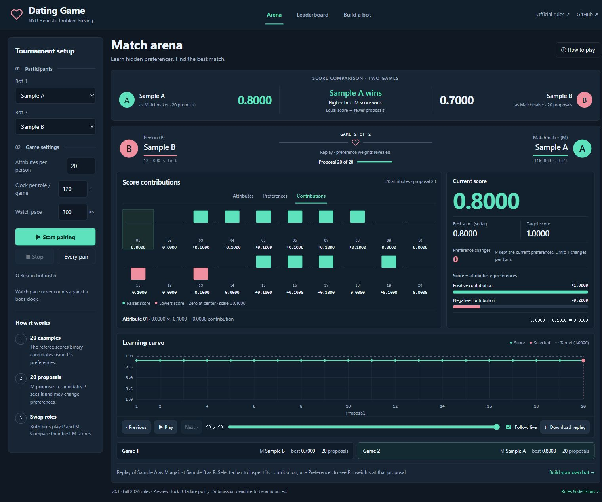

# Dating Game

The architecture for NYU **Heuristic Problem Solving — Dating Game**: a referee that runs your bots, a local browser dashboard, saved game records, and starter folders in **Python, C++ and Julia**.

Architect: **Zonghao Xu** · [zx1946@nyu.edu](mailto:zx1946@nyu.edu)

**v0.3 — architecture preview.** Built against the [Fall 2026 official rules](https://cs.nyu.edu/courses/fall26/CSCI-GA.2965-001/dating.html), checked October 22, 2026. The submission deadline, competition attribute counts and host machine will be announced separately. Clock, rounding, small-n modification limits and failure handling below are explicit architect decisions for this preview.

| | |
|---|---|
| **Runs on** | Windows, macOS and Linux; host compatibility beyond local Windows testing is still to be verified |
| **Needs** | Python 3.8+; referee uses only the standard library |
| **Roles** | Person **P** chooses preferences; matchmaker **M** proposes candidates |
| **Attributes** | 2–200; same n for both games in a pairing |
| **Examples / proposals** | 20 random binary examples, then at most 20 M proposals |
| **Clock** | Preview default: 120 seconds per bot per game; startup allowance 30 seconds |
| **Pairing** | Two games with roles swapped; higher M score wins, then fewer proposals |

**Contents:** [Quick start](#quick-start) · [Dashboard](#the-dashboard) · [Making a bot](#making-a-bot) · [Hand it in](#hand-it-in) · [Rules](#rules-the-referee-enforces) · [Protocol](docs/PROTOCOL.md) · [Architect decisions](docs/RULES.md)

---

## Quick start

```sh
git clone https://github.com/ClareXUse/dating-game.git
cd dating-game
python3 start.py
```

Open **http://127.0.0.1:8092**. On Windows, use `python` instead of `python3`. Start with the two included adaptive Python samples; no compiler or Julia installation is needed for them. Stop the server with **Ctrl+C** after the run finishes.

### What the sample bots do

**Sample A · Local search** starts from the best scored example, flips one uncertain attribute at a time, and uses feedback to keep the best candidate. **Sample B · Model learner** refits a linear preference estimate from every observed candidate and score, then tests up to three predicted improvements together. Both use only the normal bot protocol and run in separate processes; neither can see the opponent’s weights.

Their P roles choose random legal preferences and keep them fixed. Scores are calculated by the real referee. Exploration can temporarily lower scores; the best score determines the result. Some games finish early at 1, and improvement is not guaranteed on every seed or attribute count. These are teaching examples, not competitive benchmarks. Source: `bots/examples/bot.py`; starter templates remain separate.

## Receiving submissions and running classmates

Professor-provided competition settings can be recorded using the [on-site configuration worksheet](docs/ON_SITE_CONFIG.md). **Match settings** accepts a run label and instruction notes alongside n and the clock; dashboard results save this context. Notes do not change scoring or separate official standings.


See the [submission and host runbook](docs/HOST_GUIDE.md) for the complete ZIP requirements, submission address, folder placement, roster examples and commands to run received bots. These instructions live here on GitHub; the dashboard is for matches and results.

## The dashboard



1. **Set up:** choose the Person (P) strategy and Matchmaker (M) strategy for Game 1, then 2–200 attributes, the thinking clock and a watch pace. **Start pairing** plays both role assignments; **Every pair** runs the full roster.
2. **Know the outcome:** the score comparison shows both programs’ best results as M, the pairing winner and the tie-break rule. **How to play** explains both roles, the scoring loop and victory in English.
3. **Watch live:** attribute bars, proposal progress, score history and separate P/M clocks update during play. **Stop** preserves completed proposals. Watch pace is outside the thinking clock.
4. **Understand the score:** click an attribute to inspect its contribution. After a game, switch to **Preferences** for signed weights at each proposal, or **Contributions** to see which attributes raise or lower the score around a common zero line. The inspector shows the positive and negative sums and their final arithmetic. Weights stay hidden during active play.
The desktop arena keeps the selected game, attributes, score breakdown, replay controls and change log together. The full-width plot uses one grouped bar chart: each attribute has three adjacent bars for candidate value, P’s weight and score contribution. All bars share the −1 to +1 scale. Click a bar or attribute number for exact values. Weights and contributions remain hidden during play. Long change lists and larger attribute sets scroll inside their panels; smaller screens stack the panels. Scores sit in a horizontal strip above the full-width plot. The desk prioritizes readable spacing over fitting all panels into one screen; history and changes follow below. Replay controls span the match view. Expand “How to read these changes” for the score-delta explanation.

5. **Follow each decision:** the proposal strip shows candidate edits, P’s response and the referee score in order. Changed attribute bars animate from their previous values, with dashed outlines marking the old values. Beside the score history, the change table compares candidate values and revealed weights and isolates the score effect of P’s edits. Live weights remain hidden. Replay advances every 1.6 seconds; use a watch pace of 1000 ms or more to follow live changes. Reduced-motion preferences disable the animations.
6. **Replay:** step, play, seek on the chart or slider, follow live, and download JSON. **Leaderboard** shows completed-pairing standings and match history; import/export JSON locally.

Full records save to `results/<timestamp>.json` and restore automatically after a server restart. Starting a run keeps earlier results. Stopped pairings remain available for inspection and are excluded from standings. Imports stay in the browser until reload; use Export results to keep them. Old v0.1 records lack per-proposal weights, so the dashboard explains when a historical contribution is unavailable.

<details>
<summary><b>Preference and contribution screenshots</b></summary>






</details>

<details>
<summary><b>Run without the browser / on crunchy5</b></summary>

```sh
python3 start.py match "Sample A · Local search" "Sample B · Model learner" --n 20
python3 start.py tournament --n 200 --clock 120
python3 -m unittest discover -s tests -v
```

To host on crunchy5, clone and build C++ bots there, then run `python3 start.py --port 8092`. On your laptop, keep this SSH tunnel open:

```sh
ssh -J YOUR_NETID@access.cims.nyu.edu \
  -L 8092:localhost:8092 YOUR_NETID@crunchy5.cims.nyu.edu
```

Open **http://localhost:8092**. The server binds to localhost. These are setup instructions; this preview has not yet been tested on crunchy5. Browser pages on GitHub cannot launch local bot processes: clone and run the referee first.

</details>

---

## Making a bot

### 1. Copy a whole template folder

| Language | Copy this folder | Edit | Additional requirement |
|---|---|---|---|
| Python | `bots/templates/python` | `strategy.py` | Python 3.8+ |
| C++ | `bots/templates/cpp` | strategy functions in `strategy.cpp` | g++ with C++17; Python wrapper |
| Julia | `bots/templates/julia` | strategy functions in `strategy.jl` | Julia 1.6+; Python wrapper |

For example, copy `bots/templates/python` to `bots/YOUR_NETID`. Keep `bot.py`, transport code and build files intact. Templates include simple working baselines for **both roles**. They are examples to replace, not competitive strategies. C++ and Julia share the same Python JSON bridge, so their strategy code needs no third-party JSON library.

### 2. Implement both roles

In Python, the functions are:

```python
def set_preferences(state):
    # Return n weights, an ideal candidate, and an anti-ideal candidate.
    return {"weights": [...], "ideal": [...], "anti_ideal": [...]}

def modify_preferences(state):
    # You see the current candidate and previous M proposals/scores.
    return {}  # or {"weights": [...]} with a full valid new vector

def propose_candidate(state):
    # History contains the 20 initial examples and prior M proposals/scores.
    return [...]  # n attributes, each in [0, 1], at most 4 decimal places
```

See [the full input/output contract](docs/PROTOCOL.md). **This year's P sees the current candidate before modifying weights.** Do not copy the hidden-candidate behavior from old Dating Game implementations.

Bot processes and strategy variables persist within one game, including the C++/Julia child process; fresh processes start for the swapped-role game. Do not use files to transfer knowledge between games in this preview. Print debugging information to **stderr**, never stdout. This preview discards bot stderr; test your strategy directly when debugging.

### 3. Add a local roster

Copy `bots.json` to `bots.local.json`, keep a sample opponent, and add your bot inside the JSON array:

```json
[
  {"name":"Sample A", "cwd":"bots/templates/python", "command":["{python}","bot.py"]},
  {"name":"My Bot", "cwd":"bots/YOUR_NETID", "command":["{python}","bot.py"]}
]
```

For C++, add `"build":["{python}","build.py"]` to its entry. The build runs before the game clock starts. For Julia use the same `bot.py` entry; the wrapper starts `julia --startup-file=no strategy.jl`. `{python}` is replaced with the referee's Python interpreter. `cwd` is relative to the roster file. Names must be unique. Click **Rescan bot roster** after changing the roster while idle, or restart the server.

```sh
python3 start.py --bots bots.local.json
```

`bots.local.json`, received bot folders and all results are ignored by git. The public repository contains templates only.

### 4. Test before sending

```sh
python3 start.py match "My Bot" "Sample A" --bots bots.local.json --n 20
python3 start.py match "My Bot" "Sample A" --bots bots.local.json --n 100
python3 start.py match "My Bot" "Sample A" --bots bots.local.json --n 200
```

Each command tests **both P and M**. Inspect `failure` in both games: it must be `null`. Check your bot handles the full n range, normalization, precision, 20 initial examples, repeated callbacks, and finite time limits. Mention nonstandard dependencies before competition so they can be installed and checked on the host.

---

## Hand it in

Send **one ZIP of your complete copied bot folder** to **Zonghao Xu, [zx1946@nyu.edu](mailto:zx1946@nyu.edu)**.

- **Filename:** `dating-YOUR_NETID.zip`
- **Email subject:** `[Dating Game] YOUR_NETID — Bot name`
- **Include:** strategy source, the supplied wrapper, build scripts, all needed resources and a completed `SUBMISSION.md`.
- **Tell me:** author/NetID, bot name, exact runtime/compiler version, dependencies, build and launch commands, source version, and a test command/result. Emoji and six-digit hex color are optional metadata for future display.
- **Deadline:** to be announced in the course architecture announcement. An early version for communication testing is encouraged; do not wait for your strategy to be finished.

Example package:

```text
dating-YOUR_NETID.zip
└── YOUR_NETID/
    ├── bot.py
    ├── strategy.py        # or strategy.cpp + build.py, or strategy.jl
    ├── SUBMISSION.md
    └── resources/         # only if needed
```

Please send the **whole folder**, not just your strategy file, a platform-specific executable, or a link without access. Compile C++ from source on the tournament host. Keep strategies private: do not submit competing bots through a public GitHub issue or pull request. For a revision, use the same subject and identify the new version clearly.

I will test both roles and report whether the bot launches and communicates. Receiving a ZIP is different from confirming a successful test. Final competition settings and submission cutoff will appear in the course announcement.

---

## Rules the referee enforces

The [official Fall 2026 page](https://cs.nyu.edu/courses/fall26/CSCI-GA.2965-001/dating.html) is the source of the game rules. [docs/RULES.md](docs/RULES.md) separates those rules from preview decisions.

- **Preferences:** n weights in [-1, 1], at most two decimal places. Positive weights total exactly +1, negative weights exactly -1. P supplies an ideal and anti-ideal candidate; the referee verifies scores of exactly +1 and -1.
- **Candidates:** n values in [0, 1], at most four decimal places. A score is the dot product of candidate attributes and P's weights.
- **Initial examples:** the referee generates 20 candidates, each attribute independently 0 or 1 with equal probability, scores them using original weights, and gives the examples and scores to M. They do not consume M's 20 proposals or count toward its final score.
- **Each proposal:** M proposes; P sees that proposal and its previous proposal history, then may change preferences; the referee validates and applies the change, scores the candidate, and returns that score in M's next history.
- **Modifications:** at most floor(n × 5%) coordinates per turn in this preview, each within ±20% of its original weight. Changes do not compound. The normalized positive/negative totals and two-decimal precision still apply. `{}` keeps the current weights.
- **Completion:** a candidate scoring exactly 1 against the original pre-modification weights ends the game. A displayed value rounded to 1.0000 alone does not trigger success. Otherwise play ends after 20 proposals; M keeps the highest four-decimal score from its proposals.
- **Winner:** compare the two M results, score first, then fewer proposals. An exact tie is a pairing tie. This is not the sum of two scores or the best initial-example score.
- **Preview clocks:** 120 seconds total response time per bot per game; preference setup counts toward P's clock. Start/ready has a separate 30-second allowance. Build time and dashboard polling are outside the clock. Responses are requested sequentially; both processes remain alive.
- **Failures:** launch failure, invalid vector/JSON, oversized response or timeout loses that game for the failing role. For pairing comparison, a win by opponent failure ranks above a normally completed M result, which ranks above an M failure. Symmetric failures tie. Details are saved in `failure`.

## Requirements & validation

The Python referee and templates were exercised locally on Windows with Python 3.11. C++/Julia checks skip when the runtime is missing; see [validation notes](docs/VALIDATION.md) for the actual tested scope. macOS, Linux and crunchy5 verification remains pending. This local runner executes trusted bot code with the host user's permissions; it is not a process sandbox and does not enforce a memory/core quota.

| File / folder | Purpose |
|---|---|
| `start.py` | Dashboard, command-line matches and round robin |
| `referee/engine.py` | Decimal validation, dot products and preference updates |
| `referee/runner.py` | Processes, clocks, role swapping, result records |
| `referee/server.py` | Live state, run/stop controls and persisted results |
| `dashboard/` | Local tournament desk and replay controls |
| `bots/templates/` | Complete Python / C++ / Julia starter folders |
| `tests/` | Rule and process integration checks |
| `docs/` | Protocol, decisions, comparison and validation |

This workflow follows the familiar architecture pattern used in [No Tipping](https://github.com/shela-wu/no_tipping), [Kelly](https://github.com/swapn1ll/Kelly_game) and [Evasion](https://github.com/8steve8/evasion). No participant bot code or private email threads are included.
